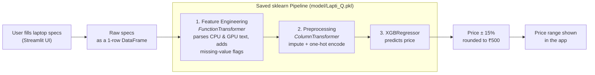

# 💻 LaptiQ: Laptop Price Predictor

**Enter a laptop's specs. Get a fair market price range for the Indian market.**

LaptiQ is an end-to-end machine learning project: a dataset of ~8,200 Indian laptop listings, a full data-cleaning and feature-engineering pipeline, a comparison of 8 regression algorithms, and a tuned **XGBoost** model served through a **Streamlit** web app.

🔗 **Live demo:** [laptiq.streamlit.app](https://laptiq.streamlit.app)

| R² Score | Avg. Prediction Error (MAPE) | Laptops Trained On |
|:---:|:---:|:---:|
| **86.26%** | **14.59%** | ~7,600 (after cleaning) |

---

## 🏗 How it works (architecture)

The whole system is **one saved scikit-learn `Pipeline`**.


---

## 📁 Project structure

```
LaptiQ/
├── app.py                        # Streamlit web app
├── requirements.txt
├── .gitignore
│
├── data/
│   ├── Laptop Dataset.csv            # raw data (8,198 rows)
│   └── Cleaned Laptop Dataset.csv    # output of the feature-engineering notebook
│
├── model/
│   └── Lapti_Q.pkl               # trained pipeline (created by train.py)
│
├── src/
│   ├── feature_engineering.py    # CPU/GPU parsing + missing flags (used in the pipeline)
│   └── train.py                  # builds, evaluates and saves the final pipeline
│
└── notebooks/
    ├── Exploratory Data Analysis.ipynb
    ├── Feature Engineering.ipynb
    ├── Linear Regression.ipynb
    ├── Decision Trees.ipynb
    ├── Random Forest.ipynb
    ├── Gradient Boosting.ipynb
    ├── KNN.ipynb
    ├── SVM.ipynb
    └── XG-BOOST.ipynb
```

---

## 🚀 Run it locally

**1. Clone and install**

```bash
git clone https://github.com/Yash-Codezz/Lapti_Q.git
cd LaptiQ
pip install -r requirements.txt
```

**2. (Optional) Retrain the model**

```bash
python src/train.py
```

**3. Launch the app**

```bash
streamlit run app.py
```

Then open the local URL Streamlit prints (usually `http://localhost:8501`).

---

## 🛠 Tech stack

| Purpose | Tools |
|---|---|
| Language | Python |
| Data & analysis | pandas, NumPy, Matplotlib, Seaborn, statsmodels (VIF) |
| Modeling | scikit-learn (Pipeline, ColumnTransformer, GridSearchCV), XGBoost |
| Persistence | joblib |
| Web app | Streamlit |
| Deployment | Streamlit Community Cloud |

---

<p align="center">Built by <b>Yash</b> · If you found this useful, consider giving the repo a ⭐</p>
